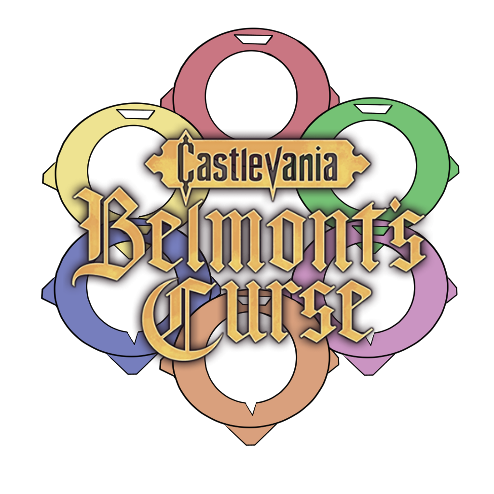

  

# Castlevania: Belmont's Curse - Archipelago World

This repository is a fork of [Archipelago](https://github.com/ArchipelagoMW/Archipelago) where I build an APWorld and a game client for **Castlevania: Belmont's Curse** (Konami / Evil Empire, 2026). The world lives in [`worlds/cvbc`](worlds/cvbc).

The goal is simple: being able to play Belmont's Curse inside an Archipelago multiworld, with Rose's chests, boss absorptions, clues, statues and Works of Mercy all becoming checks that can hold anybody's items.

Actually the project is at a very early stage. Nothing is playable for now, so please don't try to generate a seed with it yet.

Logo made by **AureOre** from the Discord, thanks a lot to her!

## The vision, in short

- Every item category of the game (Relics, Weapons, Clues, Tarot Cards, Augmentations, Work of Mercy upgrades, Key Items & Skills, EXP Statues) can be shuffled or kept vanilla, category by category, from the YAML.
- No location is ever removed: if a category is not shuffled, its locations stay and keep their vanilla item.
- Three possible goals: Bad Ending, Neutral Ending or True Ending.
- Optional progressive weapons and progressive Virtues, traps based on the game status effects, DeathLink (with 1 to 5 deaths before it triggers), and eventually enemy, boss room and entrance randomization later on.
- The logic never asks for tricks or glitches, and the client must never let the player softlock in a boss room or the room right after.

The detailed version (logic, options, design choices) is in [VISION.md](VISION.md).

## Roadmap

**Phase 1 - Game inventory (no code)**
- [x] Inventory spreadsheet: 412 items for 412 locations, 8 categories
- [x] Boss rooms, endings, progressive weapon groups, status effects
- [x] Region graph and access rules
- [x] Names for the 43 Work of Mercy checks
- [ ] List every enemy and their locations
- [ ] Last in-game verifications (a few chests and clues to confirm)

**Phase 2 - APWorld (Python)**
- [x] Fork set up, world folder created from APSkeleton
- [ ] Items, Locations, Regions, Rules, Options
- [ ] Test YAMLs and unit tests (every goal reachable, no locked seed)

**Phase 3 - Game side proof of concept**
- [ ] BepInEx 6 (IL2CPP) + UnityExplorer setup
- [ ] Find pickups, inventory, save and event flags in the game
- [ ] Minimal plugin: detect a pickup, block the vanilla item, give another one

**Phase 4 - Client (BepInEx plugin, C#)**
- [ ] Connection, send checks, receive items, save the received items
- [ ] Boss room protection, goals, Virtues, early Work of Mercy upgrades
- [ ] Traps and DeathLink
- [ ] One zip to install everything

**Phase 5 - Tracker**
- [ ] Universal Tracker support
- [ ] Maybe a PopTracker pack with a map, one day

The first milestone (v0.1) is a seed with key items, skills and chests shuffled, Neutral Ending as goal, playable from start to finish.

## Based on

- [Archipelago](https://github.com/ArchipelagoMW/Archipelago), obviously.
- [APSkeleton](https://github.com/hoppel16/APSkeleton/tree/main) by Nep. The world started from this template and I keep using it as my main reference while building it. If you want to make your own APWorld, go read it, it is very well explained.

## Contributing

Every help is welcome, from code to simple in-game checks.

- Found a bug or a wrong logic? Open an issue with the matching template.
- Got an idea to improve the project? Open an "Idea / improvement" issue, we can discuss it there.
- Want to write code? Fork the repository, work on a branch of your fork, then open a pull request. I review and merge them myself. Everything is explained in [CONTRIBUTING.md](CONTRIBUTING.md).

## A little quirk of mine

In the client and in every Archipelago message, **Jeanne d'Arc** and **Aliénor d'Aquitaine** keep their French names. No "Joan of Arc", no "Eleanor of Aquitaine". I'm French, they are French historical figures, and I like to leave my little mark on the project this way.

So if you contribute, please respect this : keep the exact spelling, with the apostrophe and the accent, in the APWorld, the client and the docs. It also avoids names that don't match between the world and the client.

## Disclaimer

This is an unofficial fan project, not affiliated with Konami or Evil Empire. You will need your own legal copy of the game (Steam version) to play it. No game file is or will be distributed here.

The Archipelago code keeps its original license (see [LICENSE](LICENSE)). APSkeleton is under the MIT license, by Nep.
